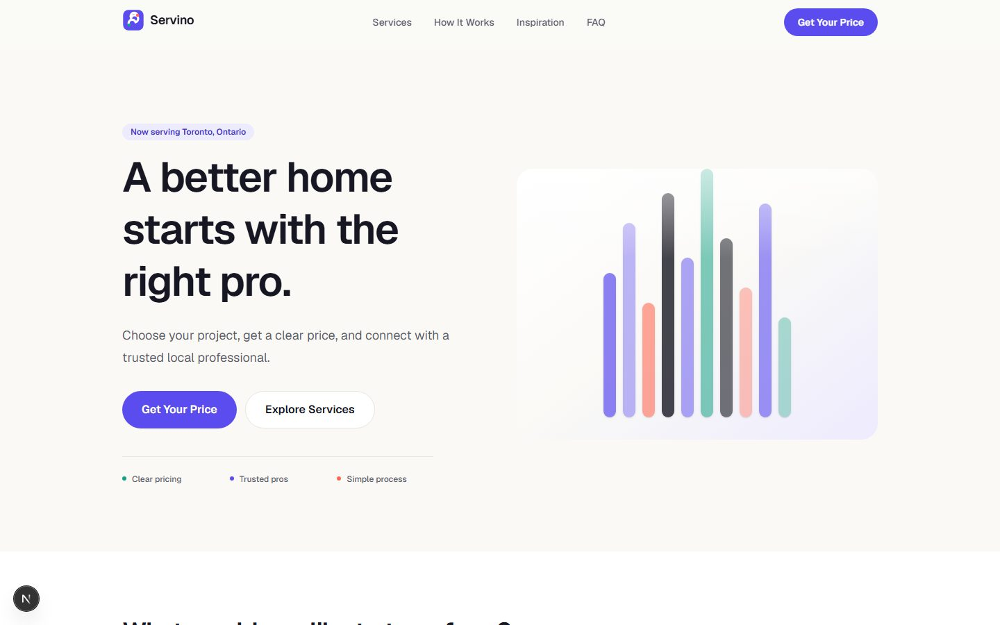
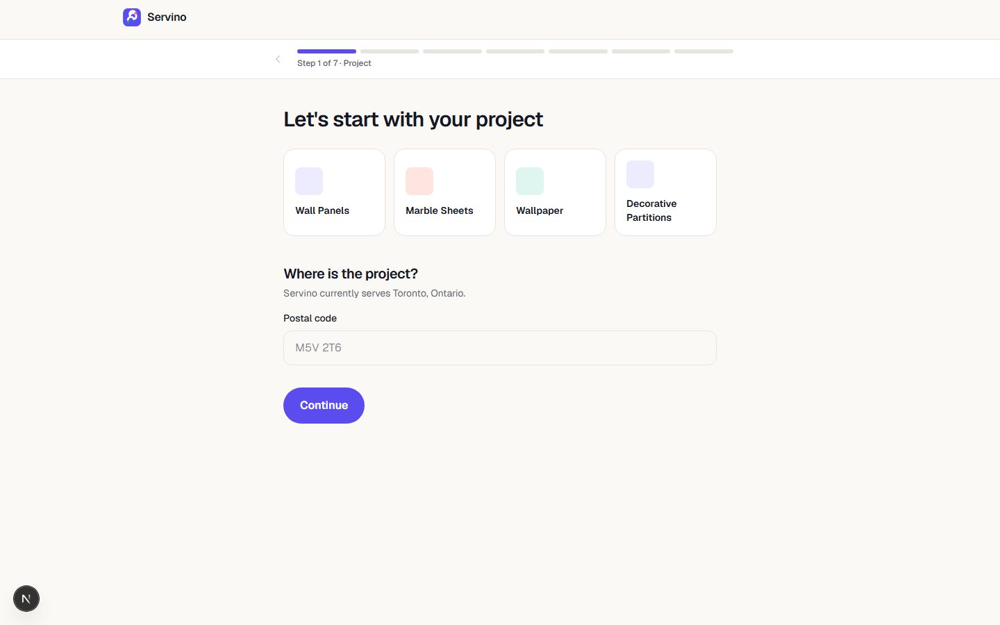
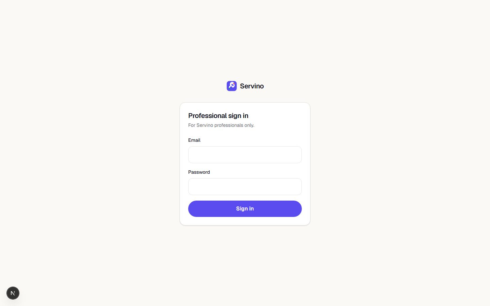
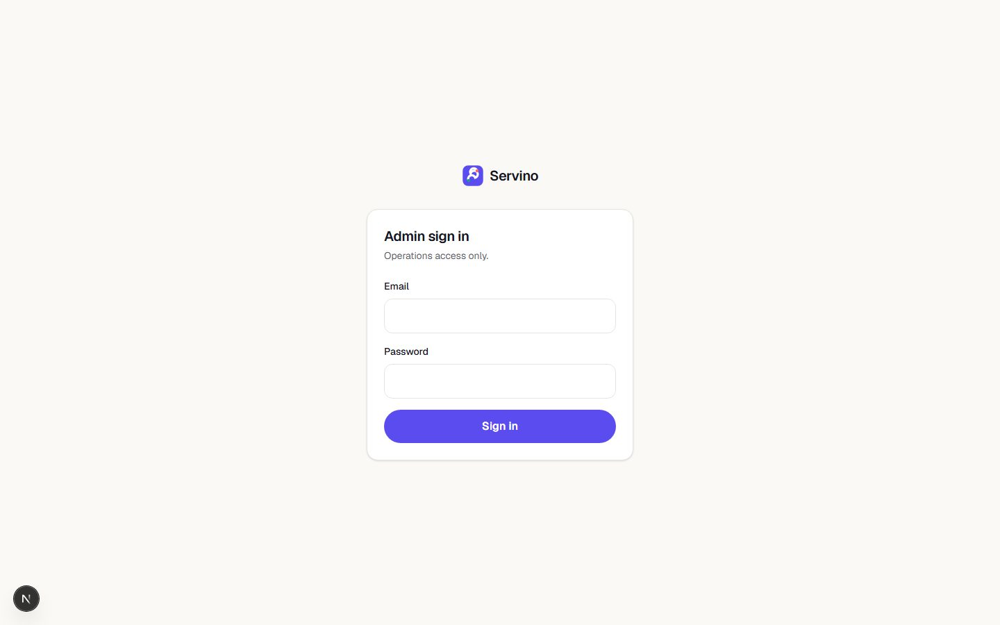
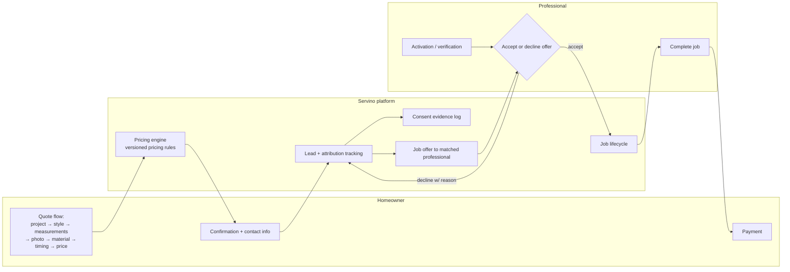

<title>Servino</title>

# Servino

A home-services marketplace connecting homeowners who need work done with verified local professionals — from instant online quotes to job completion and payment.

## The problem

Getting a home-services quote (renovation, wall makeover, and similar project types) usually means calling multiple contractors, waiting for callbacks, and getting wildly inconsistent prices with no transparency into how they were calculated. Contractors, meanwhile, spend a large share of their time on unqualified leads that never convert.

## The solution

Servino runs homeowners through a structured, multi-step online quote flow (project type → style → measurements → photos → materials → timing) that produces an instant, transparent price using a dedicated pricing engine — then routes the qualified lead to a verified professional. Professionals get a dashboard to accept or decline job offers, manage jobs to completion, and get paid.

## Screenshots

| | |
|---|---|
|  |  |
| Landing page | Customer quote flow — step 1 |
|  |  |
| Professional sign-in | Admin sign-in |

Captured locally against the dev build, local database only — no production data.

## Client / professional workflow

## Verified features

Based on the actual route structure and Prisma data model in the codebase:

- **Multi-step instant quote flow** — project type, style, measurements, material ownership, photos, timing, and a computed price, ending in a booking intent
- **Versioned pricing engine** — pricing rules are modeled as their own versioned entity (`PricingVersion`, `ServicePricingRule`), not hardcoded, so pricing can change without a code deploy
- **Lead tracking with attribution** — every lead carries funnel-step and source attribution data
- **Consent tracking** — a dedicated consent-evidence model (category, channel, timestamp) rather than an implicit checkbox
- **Professional onboarding & verification** — activation tokens, verification status, and a professional-facing session system separate from the customer/admin auth
- **Job offer → accept/decline workflow** — with structured decline-reason codes rather than free text
- **Job lifecycle tracking** through to completion, with a dedicated completion-confirmation token
- **Payments, refunds, and payouts** — modeled as first-class entities with their own status enums and an event log (`PaymentEvent`) for auditability
- **Problem/issue reporting** — both professional-reported (`ProblemReport`) and customer-reported (`CustomerIssueReport`) issue tracking with reason codes
- **Admin panel** — role-based admin users (`AdminRole`), audit event log (`AuditEvent`), and admin notes
- **Location-aware service areas** — country/province/city/service-city modeling, with at least one city-specific landing page (`/toronto/wall-makeover`) live in the route structure

## Architecture

- **Frontend:** Next.js (App Router), React 19, Tailwind CSS
- **Backend:** Next.js API routes, organized by actor (`api/customer`, `api/pro`, `api/admin`, `api/webhooks`, `api/lead`)
- **Database:** PostgreSQL via Prisma ORM — a deliberately detailed schema (50+ models/enums) covering leads, pricing, jobs, payments, and admin auditing
- **Testing:** Playwright end-to-end tests, plus a dedicated local dev/test Postgres lifecycle script (`scripts/dev-db.mjs`)
- **Validation:** Zod

## Technology stack

**Frontend:** Next.js 16, React 19, Tailwind CSS
**Backend:** Next.js API routes (Node.js)
**Database:** PostgreSQL, Prisma 6 ORM (`embedded-postgres` for local dev)
**Validation:** Zod
**Testing:** Playwright (e2e)
**Tooling:** dedicated scripts for production-env validation and admin bootstrap

## Engineering decisions worth calling out

- **Pricing as versioned data, not code.** `PricingVersion` + `ServicePricingRule` let pricing be updated and audited without a deploy — and an `EconomicsSnapshot` model suggests pricing changes are tracked against their business impact, not applied blind.
- **Consent and attribution as first-class models**, not afterthoughts bolted onto a `Lead` table — this is the kind of structure that matters once a marketplace has to answer "where did this lead actually come from" or "did we have valid consent to contact them."
- **Decline reasons and issue reports use enums, not free text** (`DeclineReasonCode`, `ProblemReasonCode`, `CustomerIssueReasonCode`) — a deliberate choice that keeps the eventual analytics on "why do professionals decline jobs" or "what goes wrong on jobs" queryable instead of requiring text mining.

## Project status

**In development.** No commits yet in the local repository — this is active, pre-launch work.

## My role

I designed and built Servino's data model, pricing engine, quote flow, and the professional/admin sides of the platform.

## What I learned

Designing the Prisma schema up front — modeling consent, attribution, pricing versions, and job-offer decline reasons as explicit entities rather than loose fields — made a real difference later: the schema itself documents the business rules (a job offer *must* have a structured decline reason; a lead *must* have consent evidence), instead of leaving those rules implicit in application code where they're easy to skip.
